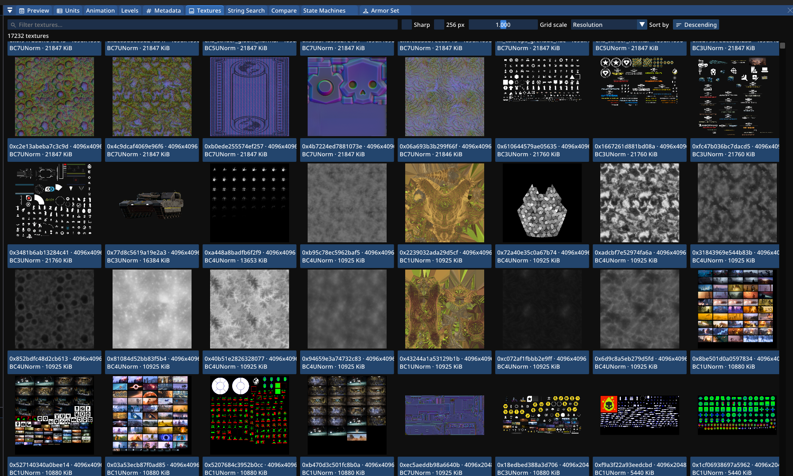
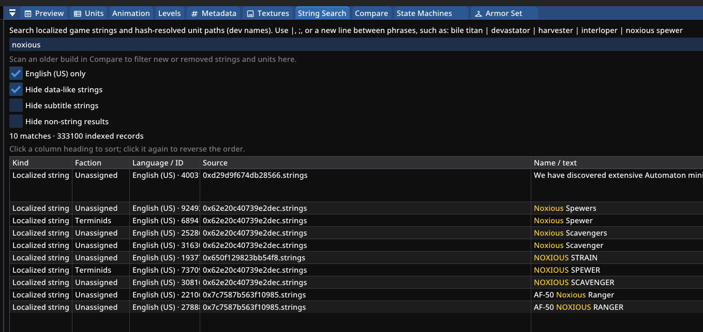
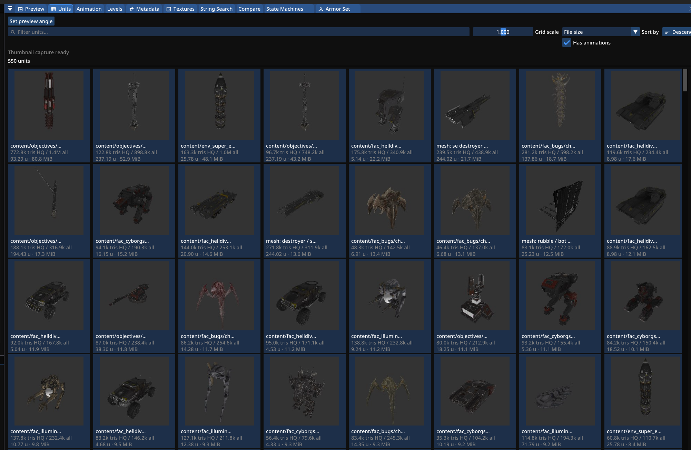
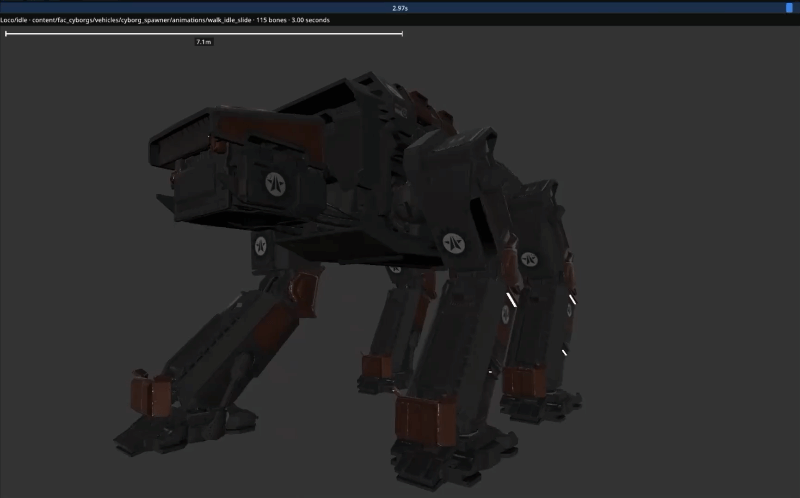
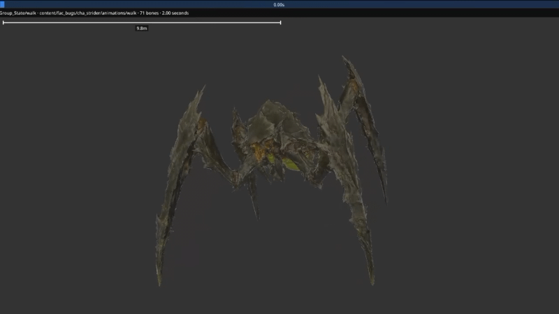

# Evil AI Filediver

**An unofficial, AI-generated fork of [Filediver](https://github.com/xypwn/filediver).** This fork adds Helldivers-focused research, browsing, comparison, animation, and preview features to the original Filediver source. The custom additions were developed with substantial AI assistance and are maintained for the `mrbluehi/evil-ai-filediver` fork.

This project is not affiliated with Arrowhead Game Studios, Sony Interactive Entertainment, or the original Filediver maintainers. The upstream project and its contributors retain their original credit and license; see the upstream [Filediver repository](https://github.com/xypwn/filediver) and the license included here. The source repository does not bundle Helldivers game archives.

## Custom feature demonstrations

### Grid based texture browser



### String search



### grid based unit browser



### Animation preview

Examples of Factory Strider and Bile Titan animation playback in the custom animation viewer:





See [CUSTOM_FEATURES.txt](CUSTOM_FEATURES.txt) for a detailed inventory of the additions in this fork that are not part of upstream Filediver.

> The download links below refer to upstream Filediver releases. They are provided for the original app and helper scripts; they are not builds of this custom fork. Build this fork from source using the instructions below, or use a fork-specific release if one is published later.

## Build this fork

From the repository root, build/run the custom GUI with:

```sh
go run ./cmd/filediver-gui
```

The GUI uses native graphics/audio bindings and therefore needs the platform build prerequisites used by upstream Filediver (including CGO and a C compiler on Windows). The CI workflow and upstream hacking notes below describe the repository build setup.

## Download
### Filediver (upstream project) GUI (graphical interface with preview)

- [Download GUI Windows (64-bit)](https://github.com/xypwn/filediver/releases/latest/download/filediver-gui-windows.exe)
- [Download GUI Linux (64-bit)](https://github.com/xypwn/filediver/releases/latest/download/filediver-gui-linux)

**Simply download and run. It's highly recommended to install all extensions when prompted.**

<details>
  <summary>Manually installing extensions</summary>

  **Do this if auto-download doesn't work for some reason. BE WARNED THAT IT'S A LOT MORE INVOLVED.**
  
  - In file expolorer, paste `%LOCALAPPDATA%\filediver` into the directory bar to open the extension folder; **all future instructions saying to "create a file/folder" will imply to do it in there**
  - Make sure to have file extensions enabled in file explorer
  - Make two folders, called `ffmpeg` and `filediver-scripts`
  - FFmpeg
	- Download https://github.com/BtbN/FFmpeg-Builds/releases/download/latest/ffmpeg-master-latest-win64-gpl.zip
	- Place the `bin` folder in `ffmpeg-master-latest-win64-gpl.zip/ffmpeg-master-latest-win64-gpl` into the `ffmpeg` directory you just created
	- Create a new text file called `ffmpeg_version` (NO EXTENSION). Edit the file with notepad, type in the text `latest` and hit save.
  - Helper scripts
	- Download [scripts_dist](https://github.com/xypwn/filediver?tab=readme-ov-file#helper-scripts-scripts_dist)
	- Place the `hd2_accurate_blender_importer` folder in `scripts-dist-windows.zip/scripts_dist` into the `filediver-scripts` directory you just created
	- Create a new text file called `filediver-scripts_version` (NO EXTENSION). Edit the file with notepad, type in the latest version of filediver (e.g. `v0.6.15`) and hit save.
</details>

### Filediver (upstream project) CLI (command-line interface)
- [Download CLI Windows (64-bit)](https://github.com/xypwn/filediver/releases/latest/download/filediver-cli-windows.zip)
- [Download CLI Linux (64-bit)](https://github.com/xypwn/filediver/releases/latest/download/filediver-cli-linux.zip)

**Extract the archive. This will create a folder named `filediver`, where everything relevant is located.**

The program is called "filediver.exe" (or just "filediver" on Linux). See [usage](#usage).

### Helper scripts (scripts_dist)
- [Windows (64-bit)](https://github.com/xypwn/filediver/releases/latest/download/scripts-dist-windows.zip)
- [Linux (64-bit)](https://github.com/xypwn/filediver/releases/latest/download/scripts-dist-linux.tar.xz)

**CLI Only: Extract the helper scripts achive into the `filediver` folder (the same folder containing the executable, e.g. `filediver.exe`).**

## Export features
- Video to bink/mp4
- Audio to ogg/aac/wav
- Images/textures to png
- 3D models to gltf/blender (with bones, textures and animations [needs flag])
- Prefabs
- Text tables to JSON
- ...and more

## Usage
**See the [Wiki](https://github.com/xypwn/filediver/wiki)**
  - [CLI Basics](https://github.com/xypwn/filediver/wiki/10-CLI-Basics)

## Links
- [HD 2 Archive Labelling](https://docs.google.com/spreadsheets/d/1oQys_OI5DWou4GeRE3mW56j7BIi4M7KftBIPAl1ULFw) (IDs can be used with -t option)
- [Helldivers Archive Discord server](https://discord.gg/y7P38h2B9Q)

## Credits
- This fork is built on the original Filediver project by xypwn and its contributors; their work made the custom additions possible.
- Thanks to Grpprofesional for inspiration and community input related to armor viewing.
- Filediver icon by @gobashroom on [HD2 Modding Discord](https://discord.gg/helldiversmodding)
- This app builds on a lot of work from other people. This includes:
	- [Hellextractor by Xaymar](https://github.com/Xaymar/Hellextractor)
		- Basic binary file structure
		- Unhashed resource names/types (.txt files)
	- [vgmstream](https://github.com/vgmstream/vgmstream), [ww2ogg by hcs](https://github.com/hcs64/ww2ogg) and [bnkextr by eXpl0it3r](https://github.com/eXpl0it3r/bnkextr)
		- Wwise audio formats
	- [ImageMagick](https://imagemagick.org)
		- DDS texture decoding
	- [Accurate HD2 Shader by Thejudsub](https://discord.com/channels/1210541115829260328/1222290154409033889) on [the Helldivers Archive Discord server](https://discord.gg/y7P38h2B9Q)
		- The most accurate Blender material replicating the game's procedural shaders

## Hacking
### Running
- `go run ./cmd/filediver-cli` / `go run ./cmd/filediver-gui`
### Setup blender importer for development
- `uv venv --python 3.11`
- `uv pip install -r scripts/requirements.txt`
- `set FILEDIVER_BLENDER_IMPORTER_COMMAND=uv run scripts/hd2_accurate_blender_importer.py` (CMD) or `$env:FILEDIVER_BLENDER_IMPORTER_COMMAND="uv run scripts/hd2_accurate_blender_importer.py"` (PowerShell)

## License
Copyright (c) filediver contributors

FileDiver is licensed under the 3-Clause BSD License (https://opensource.org/license/bsd-3-clause).
